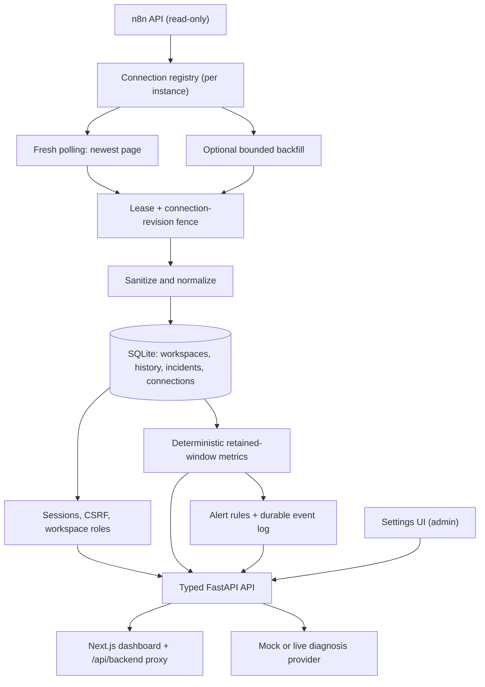

# FlowMedic AI

[](https://github.com/ShubhxYT/FlowMedic-n8n/actions/workflows/ci.yml)


**AI-powered observability and incident diagnosis for automation workflows.**

FlowMedic turns failed n8n executions into persistent, sanitized incidents and provides
structured AI-assisted diagnosis suggestions for human review. It supports multiple isolated
workspaces, GUI-managed n8n/AI connections, and per-instance monitoring, and is built for
automation engineers, AI engineers, technical operations teams, and agencies managing n8n
workflows.

## Live deployment

| Piece | URL |
|---|---|
| Dashboard | <https://flowmedic.shubhsomani.tech> |
| API | <https://api.flowmedic.shubhsomani.tech> |

The public deployment runs on a single Vultr Cloud Compute instance managed by Coolify. Real
data requires a user session; the API host itself rejects requests that do not come through the
authenticated dashboard proxy (or carry the optional internal service token).

## The problem

Automation failures can be silent, difficult to trace, and expensive to investigate. Raw
execution payloads may be large or sensitive, while the useful context—what failed, where,
and when—is scattered across workflow and execution data.

## What FlowMedic does today

- Uses **read-only** n8n API calls to check connectivity, list workflows, and inspect recent
  failed executions.
- Normalizes failures into a small, sanitized incident record; repeated syncs do not create
  duplicate incidents for the same execution.
- Persists incidents and their latest diagnosis in SQLite through SQLAlchemy, with an
  append-only metadata audit log.
- Runs a durable, read-only monitoring loop **per n8n instance**. Every cycle polls the newest
  execution page first; a separate bounded cursor backfills older pages without delaying fresh
  failure discovery.
- Isolates history, incidents, checkpoints, leases, metrics, alert state, and retention by
  workspace **and** n8n instance, so two servers can reuse the same workflow/execution IDs.
- Derives deterministic workflow health and global metrics from persisted history—not from an
  LLM—and exposes unavailable data as unknown rather than guessing.
- Generates typed, uncertainty-aware diagnosis suggestions using either a deterministic mock
  provider or an OpenAI-compatible structured-output provider.
- Provides a responsive Next.js dashboard for overview, workflows, incidents, incident detail,
  alerts, and settings.
- Lets workspace admins add, test, enable, disable, and delete n8n and AI connections from
  Settings. Credentials are encrypted at rest and never returned by the API.
- Records deterministic alert-rule decisions for new incidents, unhealthy workflows, and
  degraded monitoring. The included provider is local/mock only and is disabled until a rule is
  explicitly enabled.

FlowMedic is an investigation aid. It does not modify workflows, apply fixes, or claim that a
diagnosis is certain.

## Accounts and workspaces

- **Private workspaces.** Signup creates a new workspace with the new account as its admin.
  Existing records belong to the reserved legacy operator workspace.
- **Roles.** Admins manage connections, members, alert rules, sync, and diagnosis. Viewers can
  read workspace data but cannot mutate it or trigger upstream requests.
- **Invitations.** Admins create single-use, expiring invitation links. Accepting an invite adds
  the account to that workspace; existing memberships keep their current role.
- **Sessions.** Opaque 256-bit session tokens are stored hashed and can be revoked. Concurrent
  sessions are bounded, logout revokes the current session, and password reset, disablement, or
  membership removal takes effect on the next request.
- **CSRF and origins.** Every mutation requires an exact trusted `Origin` plus a CSRF cookie /
  header pair. Authenticated mutations also verify the session's stored CSRF hash.
- **Throttling.** Signup/login use durable 15-minute budgets per account and per peer address.

The legacy operator account is provisioned explicitly with the local CLI; public signup can
never claim legacy records. See [account operations](docs/operations.md#accounts-and-workspace-ownership).

## Managed connections and per-instance monitoring

Connections are authoritative in SQLite after an explicit import; runtime never falls back to
`N8N_*` or `AI_*` environment credentials.

- **Encrypted credentials.** Keys are encrypted with Fernet using a deployment keyring that
  supports key rotation. The authenticated envelope binds ciphertext to its workspace and
  connection ID, so a token moved between records fails closed.
- **Optimistic revisions.** Every saved mutation and test uses an expected revision; stale
  requests return `409`. Soft-deleted connections keep their identity, history, and audit trail
  while clearing ciphertext and the default selection.
- **Explicit enabling.** New connections are saved disabled. Enabling is a separate admin
  action; connection tests never save, enable, or change defaults.
- **Per-instance workers.** A connection registry reconciles enabled instances every few seconds
  and after committed changes. Each worker owns one instance's lease, cursor, history, incidents,
  alerts, and retention. Before every write it re-checks the connection revision and lease so a
  disabled, deleted, or superseded worker cannot persist stale data.
- **Safe outbound policy.** Operator-configured destinations are allowlisted by exact origin;
  DNS answers are checked, redirects are rejected, and responses are size-bounded. Production
  requires an explicit egress acknowledgment (`OUTBOUND_EGRESS_ENFORCED=true`).
- **Legacy import.** The existing environment credentials can be imported once into the legacy
  workspace with the local CLI (see [Operator commands](#operator-commands)). Imported records
  stay disabled until an admin tests and enables them in Settings.

## Architecture



The dashboard consumes the FastAPI API through its same-origin proxy; it does not call n8n or an
AI provider directly. Diagnosis is advisory output from the configured provider, not an automated
repair action.

```text
app/
  api/                 FastAPI routes, auth, settings, dependencies
  core/                Settings, database, encryption, outbound policy, safe errors
  models/              Auth, audit, connection, and business models
  repositories/        Scoped persistence and idempotency
  services/            Monitoring, registry, connections, alerts, health, auth
  integrations/n8n/    Read-only n8n client and upstream schemas
  ai/                  Diagnosis provider interface and adapters
  schemas/             Public Pydantic request/response models
  commands/            Bootstrap, import, account, and backup CLIs
frontend/
  app/                 Next.js App Router pages and authenticated proxy
  components/          Dashboard, settings, and connection UI
  lib/                 Typed API client, types, formatting, and hooks
alembic/               Migrations 0001–0006
tests/                 Offline backend and API tests
```

## Tech stack

| Area | Technologies |
|---|---|
| Backend | Python, FastAPI, Pydantic, SQLAlchemy, SQLite, Alembic, httpx, cryptography |
| Frontend | Next.js, React, TypeScript, Tailwind CSS |
| AI | Provider abstraction, OpenAI-compatible structured-output adapter, deterministic mock provider |
| Quality | pytest, Ruff, Vitest, ESLint, TypeScript |
| Infrastructure | Docker, Docker Compose, Coolify, GitHub Actions |

## Engineering decisions

- **Read-only n8n integration:** the client issues API reads only; FlowMedic has no workflow
  write or repair capability.
- **Instance-scoped identity:** incidents, history, checkpoints, alert events, and condition
  states are unique by workspace + instance. The same external execution ID can exist on two
  servers; a duplicate within one instance still fails.
- **Fresh-first cursor strategy:** every scheduled cycle reads n8n's newest page with no cursor.
  A separate opaque backfill cursor advances older pages in bounded work; no execution-ID ordering
  is assumed.
- **Multi-process ownership lease:** SQLite stores an expiring, refreshable lease per instance.
  A local async lock prevents overlap in one process, while the lease safely contends across
  processes and recovers after a crash or expiry.
- **Fenced persistence:** every poll write re-checks the lease owner and connection revision in
  the same transaction. Stale results are rejected instead of overwriting newer state.
- **Bounded retention:** execution history is deleted in configured batches after its retention
  window; incidents and checkpoints are never deleted by that cleanup.
- **Safe operational logs:** concise events cover fresh polls, backfill, lease contention and
  recovery, retries, and retention counts without recording API keys, credentials, or execution
  payloads.
- **Bounded recovery:** timeouts, connectivity failures, rate limits, and n8n 5xx responses
  receive bounded exponential retries; authentication and configuration errors do not. An
  unavailable or oversized execution detail is skipped instead of aborting the page.
- **Sanitized failure context:** the normalizer deliberately excludes execution `runData`, node
  inputs/outputs, credentials, and the raw upstream error object. Known secrets, bare token-shaped
  values, URLs, and email addresses are redacted before persistence and before any AI prompt.
- **Typed public API:** FastAPI response models define workflow, failure, incident, diagnosis,
  connection, configuration-status, and error shapes. Validation errors are returned as a fixed
  safe message.
- **Explicit uncertainty:** confidence is shown as a provider estimate, not a calibrated
  probability; suggested fixes require review.
- **Independent delivery checks:** CI runs Python checks on Python 3.12 and 3.13, frontend
  lint/typecheck/tests/build, and separate backend and dashboard Docker builds.
- **Safe alert delivery:** rules are disabled by default. Trigger state, cooldown windows,
  event deduplication, and delivery attempts are persisted. The mock provider remains local; the
  optional HTTPS webhook provider sends only a minimal, signed event payload.

## Safety and reliability

- FlowMedic never automatically modifies n8n workflows.
- Diagnosis suggestions require human review before any production change.
- Passwords are hashed with Argon2; session and invitation tokens are opaque and stored only as
  SHA-256 hashes.
- Connection credentials are encrypted at rest and never returned by the API. Responses expose
  only `has_api_key`.
- API responses do not return configured API keys, connection strings, upstream response bodies,
  stack traces, or raw provider errors.
- Sensitive values are sanitized before failure context is persisted or passed to a diagnosis
  provider.
- Mutating routes require a session and CSRF; the optional service token never substitutes for
  user authority.
- Demo mode contains one fixed synthetic incident and mock diagnosis only; it never contacts
  n8n or a live AI provider. It also seeds clearly synthetic healthy, degraded, and unhealthy
  workflow history for the dashboard.
- Offline tests and CI use mocked n8n/AI HTTP interactions, so real credentials are not required.
  Optional live n8n validation is opt-in and never runs in CI.
- Alert delivery is at-least-once from FlowMedic's perspective: durable event keys and attempt
  records reduce duplicates, but exactly-once delivery cannot be guaranteed without cooperation
  from an external provider.

## Local development

### 1. Start the FastAPI backend

```bash
git clone https://github.com/ShubhxYT/FlowMedic-n8n.git
cd FlowMedic-n8n
python -m venv .venv
# Linux/macOS
source .venv/bin/activate
# Windows PowerShell: .\.venv\Scripts\Activate.ps1
python -m pip install -e ".[dev]"
cp .env.example .env
```

Set the local HTTP auth policy in `.env`:

```dotenv
AUTH_ALLOW_INSECURE_COOKIES=true
AUTH_TRUSTED_ORIGINS=http://localhost:3000,http://127.0.0.1:3000
```

Application startup expects an up-to-date database:

```bash
alembic upgrade head
python -m app.commands.bootstrap_owner owner@example.com
python -m uvicorn app.main:app --host 127.0.0.1 --port 8000 --no-access-log
```

`bootstrap_owner` prompts for the password twice with hidden input and is idempotent for the
same operator. It creates the legacy workspace admin and never changes an existing password on
repeat runs.

To manage connections from Settings, add a Fernet keyring to `.env` once:

```bash
python - <<'PY'
from cryptography.fernet import Fernet
print("CONNECTION_ENCRYPTION_KEYS=" + '{"local":"' + Fernet.generate_key().decode() + '"}')
print("CONNECTION_ACTIVE_KEY_ID=local")
PY
```

For local outbound tests, set `DEPLOYMENT_ENVIRONMENT=development`,
`OUTBOUND_ALLOW_LOCAL_HTTP=true`, and an `OUTBOUND_DESTINATIONS` JSON list such as
`[{"origin":"http://127.0.0.1:5678","allow_private":true}]`. Production uses HTTPS origins and
requires `OUTBOUND_EGRESS_ENFORCED=true`.

### 2. Start the dashboard

In a second terminal:

```bash
cd frontend
cp .env.example .env.local
npm ci
npm run dev
```

The frontend defaults to the same-origin `/api/backend` proxy. Set the server-only
`BACKEND_INTERNAL_URL=http://127.0.0.1:8000` in `.env.local`; never place a provider key, master
key, or service token in any `NEXT_PUBLIC_` variable.

## Environment variables

| Variable | Default | Purpose |
|---|---|---|
| `N8N_BASE_URL` | unset | Legacy import only; URL with no credentials embedded |
| `N8N_API_KEY` | empty | Legacy import only; never returned through the API |
| `DATABASE_URL` | `sqlite:///./flowmedic.db` | SQLAlchemy database connection |
| `AI_API_KEY` | empty | Legacy import only; selects a live compatible provider after import |
| `AI_BASE_URL` | `https://api.openai.com/v1` | Trusted OpenAI-compatible base URL |
| `AI_MODEL` | `gpt-4.1-mini` | Model expected to support strict JSON-schema output |
| `FLOWMEDIC_API_KEY` | empty | Optional internal service token; user sessions are independently required |
| `DIAGNOSE_RATE_LIMIT_PER_MINUTE` | `5` | Per-caller diagnosis limit; in-memory, per process |
| `CONNECTION_ENCRYPTION_KEYS` | empty | JSON object of key IDs to Fernet keys; deployment secret |
| `CONNECTION_ACTIVE_KEY_ID` | empty | Key ID used for new ciphertext; must exist in the keyring |
| `CONNECTION_RECONCILE_SECONDS` | `5` | Registry reconciliation interval; 1–60 seconds |
| `CONNECTION_POLL_CONCURRENCY` | `4` | Shared polling concurrency bound; 1–16 |
| `DEPLOYMENT_ENVIRONMENT` | `production` | `development` or `production` |
| `OUTBOUND_DESTINATIONS` | `[]` | JSON list of `{"origin": "...", "allow_private": false}` entries |
| `OUTBOUND_ALLOW_LOCAL_HTTP` | `false` | Development-only HTTP destinations |
| `OUTBOUND_EGRESS_ENFORCED` | `false` | Acknowledges deployment-level egress controls; required in production |
| `DEMO_MODE` | `false` | Synthetic, credentials-free demo; cannot be combined with n8n or AI keys |
| `PUBLIC_DEMO_READONLY` | `false` | Public read-only demo; requires `DEMO_MODE=true` |
| `CORS_ALLOW_ORIGINS` | local dashboard origins | Comma-separated frontend origins permitted by FastAPI |
| `AUTH_REGISTRATION_ENABLED` | `false` | Explicit policy for public private-workspace signup |
| `AUTH_ALLOW_INSECURE_COOKIES` | `false` | Allow HTTP cookies only for loopback development origins |
| `AUTH_TRUSTED_ORIGINS` | `https://localhost:3000` | Exact allowed mutation origins, comma-separated |
| `AUTH_SESSION_SECONDS` | `43200` | Absolute session lifetime |
| `AUTH_INVITE_SECONDS` | `86400` | Single-use invitation lifetime |
| `TRUST_PROXY_IP` | `false` | Trust `X-Forwarded-For` only behind a sanitizing ingress |
| `API_DOCS_ENABLED` | `false` | Explicitly enable docs only for private development |
| `MONITOR_POLL_INTERVAL_SECONDS` | `60` | Read-only polling cadence; 10–3600 seconds |
| `MONITOR_PAGE_SIZE` | `50` | n8n execution page size; 1–100 |
| `MONITOR_BACKFILL_PAGES_PER_CYCLE` | `1` | Bounded older-page work after the fresh poll; 0 disables backfill |
| `MONITOR_LEASE_SECONDS` | `120` | SQLite lease expiry for cross-process polling ownership |
| `MONITOR_MAX_RETRIES` | `3` | Maximum transient retry attempts per poll |
| `MONITOR_RETRY_BASE_SECONDS` | `2` | Initial exponential-backoff delay |
| `EXECUTION_HISTORY_RETENTION_DAYS` | `30` | Retained execution-history window; incidents are not deleted |
| `RETENTION_CLEANUP_INTERVAL_SECONDS` | `86400` | Minimum interval between retention cleanup attempts |
| `RETENTION_CLEANUP_BATCH_SIZE` | `500` | Maximum history records deleted in one cleanup run |
| `ALERT_DEFAULT_COOLDOWN_SECONDS` | `300` | Suggested cooldown when creating an alert rule; 60–86400 seconds |
| `ALERT_MAX_RETRIES` | `3` | Maximum persisted attempts for one alert event |
| `ALERT_WEBHOOK_URL` | unset | Enables the webhook provider only for a globally routable HTTPS endpoint |
| `ALERT_WEBHOOK_TIMEOUT_SECONDS` | `5` | Strict outbound webhook timeout; greater than 0 and at most 15 seconds |
| `ALERT_WEBHOOK_SIGNING_SECRET` | empty | Optional HMAC-SHA256 signing secret; never persisted or returned |
| `NEXT_PUBLIC_API_BASE_URL` | `/api/backend` | Same-origin browser proxy prefix |
| `BACKEND_INTERNAL_URL` | `http://127.0.0.1:8000` | Server-only API URL used by the dashboard proxy |

## Demo mode

Demo mode makes the full dashboard flow inspectable without n8n or AI credentials. It seeds
one persistent, clearly synthetic workflow failure, a deterministic mock diagnosis, and small
synthetic execution histories that exercise healthy, degraded, and unhealthy dashboard states.

```bash
DEMO_MODE=true PUBLIC_DEMO_READONLY=true DATABASE_URL=sqlite:///./flowmedic-demo.db \
  alembic upgrade head
DEMO_MODE=true PUBLIC_DEMO_READONLY=true DATABASE_URL=sqlite:///./flowmedic-demo.db \
  python -m uvicorn app.main:app --host 127.0.0.1 --port 8000 --no-access-log
```

Then start the dashboard as above. Do not use demo mode with `N8N_API_KEY` or `AI_API_KEY`.
Public demo visitors can read synthetic data but cannot mutate state or reach real workspaces.

## API

Real business routes require a user session, and mutations additionally require an allowed
Origin and CSRF token. `/health` is public. Interactive documentation and OpenAPI are disabled
by default; `API_DOCS_ENABLED=true` enables them for private development only.

### Accounts

| Method | Path | Purpose |
|---|---|---|
| `GET` | `/api/v1/auth/csrf` | Issue/read the CSRF cookie and registration policy |
| `POST` | `/api/v1/auth/signup` | Create a private workspace (when registration is enabled) |
| `POST` | `/api/v1/auth/login` | Create a revocable session and rotate the CSRF token |
| `POST` | `/api/v1/auth/logout` | Revoke the current session |
| `GET` | `/api/v1/auth/me` | Current user, workspace, role, and memberships |
| `POST` | `/api/v1/auth/workspace` | Switch to another membership; rotates the session |
| `GET`, `POST` | `/api/v1/auth/invites` | List/create expiring invitations (admin) |
| `DELETE` | `/api/v1/auth/invites/{invite_id}` | Revoke an invitation (admin) |
| `POST` | `/api/v1/auth/invites/accept` | Accept an invitation with its fragment token |
| `GET` | `/api/v1/auth/members` | List workspace members (admin) |
| `PATCH`, `DELETE` | `/api/v1/auth/members/{user_id}` | Change a role or remove a member (admin) |

### Connections

| Method | Path | Purpose |
|---|---|---|
| `GET` | `/api/v1/settings/n8n-instances` | Safe, workspace-scoped connection list |
| `POST` | `/api/v1/settings/n8n-instances` | Create a disabled connection (admin) |
| `PATCH` | `/api/v1/settings/n8n-instances/{id}` | Edit, enable/disable, replace/remove key, or confirm a same-server URL change (admin) |
| `DELETE` | `/api/v1/settings/n8n-instances/{id}` | Soft-delete with `If-Match: "<revision>"` (admin) |
| `POST` | `/api/v1/settings/n8n-instances/test` | Test an unsaved candidate; never persists (admin) |
| `POST` | `/api/v1/settings/n8n-instances/{id}/test` | Test a saved revision with optional unsaved changes (admin) |
| `GET`, `POST`, `PATCH`, `DELETE` | `/api/v1/settings/ai-providers[...]` | Same contract for AI providers, plus default selection |
| `POST` | `/api/v1/settings/ai-providers/{id}/test` | `access` or cost-acknowledged `structured_output` probe (admin) |

### Monitoring and data

| Method | Path | Purpose |
|---|---|---|
| `GET` | `/api/v1/system/status` | Safe workspace configuration state |
| `GET` | `/api/v1/n8n/status?instance_id=...` | Check n8n read access for one instance |
| `GET` | `/api/v1/monitoring/status[?instance_id=...]` | Per-instance polling state (`{"items": [...]}`) |
| `POST` | `/api/v1/monitoring/sync?instance_id=...` | Fresh polling plus bounded idempotent backfill (admin) |
| `GET` | `/api/v1/metrics/overview[?instance_id=...]` | Persisted workflow-health metrics |
| `GET` | `/api/v1/metrics/workflows[?instance_id=...]` | Persisted health rows |
| `GET` | `/api/v1/workflows/{workflow_id}/health?instance_id=...` | One workflow's deterministic health |
| `GET` | `/api/v1/workflows?instance_id=...` | Sanitized workflow summaries with cursor pagination |
| `GET` | `/api/v1/executions/failed?instance_id=...` | Normalized failures from a recent execution page |
| `POST` | `/api/v1/incidents/sync?instance_id=...` | Explicitly ingest failures (admin) |
| `GET` | `/api/v1/incidents[?instance_id=...]` | List persisted incidents |
| `GET` | `/api/v1/incidents/{incident_id}` | Read one incident |
| `PATCH` | `/api/v1/incidents/{incident_id}` | Resolve an incident with `{"status": "resolved"}` |
| `POST` | `/api/v1/incidents/{incident_id}/diagnose[?force=true]` | Generate and persist an advisory diagnosis (admin) |
| `GET`, `POST`, `PATCH` | `/api/v1/alerts/rules` | View or configure alert rules |
| `GET` | `/api/v1/alerts/events[?instance_id=...]` | Persisted alert-event history |
| `GET` | `/api/v1/alerts/events/{event_id}/deliveries` | Safe, persisted delivery attempts |
| `GET` | `/api/v1/demo` | Synthetic demo metadata; only with `DEMO_MODE=true` |

Live workflow, execution, and sync routes require `instance_id`. List/metric routes accept an
optional filter; archived instances remain valid for historical views. The backend never
silently chooses the first instance. Error responses use the safe shape
`{"error":{"code":"...","message":"..."}}`.

### Webhook alert delivery

The default `mock` provider records a local delivery attempt and never contacts an external
service. Set `ALERT_WEBHOOK_URL` to enable the `webhook` provider, then explicitly create an
enabled rule with `delivery_provider: "webhook"`. Rules selecting an unavailable webhook are
rejected; webhook URLs and signing secrets never appear in API responses.

Webhook delivery is intentionally conservative: only HTTPS URLs with a direct, globally
routable IP address are accepted. Localhost, loopback, private, link-local, reserved, and DNS
hostname destinations are rejected. Redirects are never followed, the response body is not
processed, and requests use the configured strict timeout.

```json
{
  "version": 1,
  "event": {
    "id": "event UUID",
    "trigger_type": "new_incident",
    "incident_id": "incident UUID or null",
    "workflow_id": "workflow ID or null",
    "created_at": "ISO-8601 timestamp"
  },
  "delivery": { "attempt": 1 }
}
```

When `ALERT_WEBHOOK_SIGNING_SECRET` is set, FlowMedic adds `X-FlowMedic-Timestamp` and
`X-FlowMedic-Signature` (`v1=<hex hmac-sha256>` over `<timestamp>.<canonical JSON body>`).
Receivers should reject stale timestamps and verify with a constant-time comparison.

Only 2xx responses are delivered. Timeouts, network failures, HTTP 429, and 5xx responses consume
the bounded retry budget; other 4xx responses fail immediately.

### Health rules

Health uses each workflow's latest 20 persisted execution records within one workspace and
instance:

- **Unknown:** no classified success/failure history is available.
- **Healthy:** classified executions contain no failures and no open incidents.
- **Degraded:** a recent failure or open incident exists, but the unhealthy rules do not.
- **Unhealthy:** two or more recent failures, a failure with no recent success, or two or more
  open incidents exist.

The global success/failure counts use the latest 100 persisted records. With retention enabled,
all rates and health states are calculated from retained history, not lifetime data. These are
deterministic rules and not AI-generated judgments.

## Live n8n validation

CI is intentionally offline. To validate a real, non-production n8n instance locally, set
`N8N_BASE_URL` and `N8N_API_KEY` in `.env`, then explicitly opt in:

```bash
RUN_LIVE_N8N_VALIDATION=true python -m pytest -q -m integration
```

Use a harmless test workflow and create one normal run plus one controlled failure. Then call
`POST /api/v1/monitoring/sync?instance_id=...`, inspect `GET /api/v1/monitoring/status`, and run
the same sync again to confirm that history and incidents are not duplicated. The test and API
only read n8n; they never trigger, replay, modify, or repair a workflow. Do not commit `.env` or
credentials.

## Docker Compose

```bash
cp .env.example .env
docker compose up --build
```

Compose runs a one-shot `migrate` service (`alembic upgrade head`) before starting the API. The
API starts only after migration completes successfully; if migration fails, Compose does not
start the API. The migration service and API share the same persistent SQLite volume. The API
and dashboard are available at `http://127.0.0.1:8000` and `http://127.0.0.1:3000`.

The API image also runs the Settings-aware `upgrade_database(DATABASE_URL)` helper before uvicorn
so single-container deployments (Coolify, plain Docker) migrate the mounted volume. Do not run
multiple API replicas against the same SQLite file; use a separate migration job if you ever add
replicas.

## Operator commands

Run these inside the API environment (or `docker compose exec api ...`):

```bash
# Provision the legacy workspace admin (idempotent, hidden password prompt)
python -m app.commands.bootstrap_owner owner@example.com

# Reset a password, disable an account, or revoke every session
python -m app.commands.account reset owner@example.com
python -m app.commands.account disable owner@example.com
python -m app.commands.account revoke owner@example.com

# Import the legacy N8N_*/AI_* credentials into encrypted, disabled connections
python -m app.commands.import_connections --workspace-id 00000000-0000-0000-0000-000000000001

# Consistent SQLite backup using the online backup API
python -m app.commands.backup /data/backups/flowmedic.db
```

After import, an admin tests and enables each connection in Settings and selects the AI default.
See [operations](docs/operations.md) for backup, restore, cookie, CSRF, and recovery guidance.

## Testing and CI

```bash
# Backend
alembic upgrade head
python -m pytest -q
python -m ruff check .

# Frontend
cd frontend
npm run lint
npm run typecheck
npm test
npm run build
```

The GitHub Actions workflow contains `backend` (Python 3.12 and 3.13), `frontend`, and `images`
(jobs that build both Dockerfiles) and runs on push and pull request.

## Vultr deployment (Coolify)

This stack runs on a single Vultr Cloud Compute instance in the Mumbai (`bom`) region.

| Piece | Where it runs |
|---|---|
| Vultr Cloud Compute | `vc2-2c-4gb` (2 vCPU / 4 GB / 80 GB) Ubuntu 24.04, `flowmedic-ai` |
| Coolify 4.6 | Self-hosted on the same VM at `https://coolify.vultr.shubhsomani.tech` |
| FastAPI backend | `https://api.flowmedic.shubhsomani.tech` (Dockerfile build, `/data` volume) |
| Next.js dashboard | `https://flowmedic.shubhsomani.tech` (Dockerfile build, same-origin `/api/backend` proxy) |
| TLS | Coolify's built-in proxy (Let's Encrypt) |
| DNS | Cloudflare `A` records → `65.20.70.206` |
| Vultr firewall | inbound 80/443 public; 22/8000/6001/6002 restricted to the operator IP and GitHub hook ranges |
| n8n upstream | existing `https://n8n.happynestfarm.in`, read-only API key |

Pushes to `main` hit two repository webhooks (one per Coolify application). Coolify pulls the
commit, rebuilds the affected image, runs the container command (migration then uvicorn), waits
for the healthcheck, and rolls back on failure.

Required production configuration:

- `DATABASE_URL=sqlite:////data/flowmedic.db` with a persistent `/data` volume.
- `AUTH_TRUSTED_ORIGINS=https://flowmedic.shubhsomani.tech` and
  `AUTH_ALLOW_INSECURE_COOKIES=false`.
- `CONNECTION_ENCRYPTION_KEYS` + `CONNECTION_ACTIVE_KEY_ID` kept outside the database volume.
- `DEPLOYMENT_ENVIRONMENT=production`, `OUTBOUND_DESTINATIONS` with the real n8n/AI origins, and
  `OUTBOUND_EGRESS_ENFORCED=true` once network egress is restricted.
- The same `FLOWMEDIC_API_KEY` on the API and dashboard; the dashboard's `BACKEND_INTERNAL_URL`
  points at the API and `NEXT_PUBLIC_API_BASE_URL=/api/backend`.

The browser never calls the API host directly: the dashboard uses the
`/api/backend/[...path]` route handler, which forwards the optional internal token plus the
browser's session/CSRF cookies. The backend validates user membership independently of that
token. API and dashboard access to real data both require a user session.

Redeploy by hand:

```bash
curl -X POST -H "Authorization: Bearer $COOLIFY_API_TOKEN" \
  -H 'Content-Type: application/json' \
  -d '{"uuid":"<application-uuid>","force":true}' \
  https://<coolify-host>:8000/api/v1/deploy
```

## Roadmap

**Completed**

- Core FastAPI backend and typed API
- Incident persistence with idempotent ingestion, resolution, and sanitized context
- AI diagnosis provider abstraction and deterministic demo mode
- SaaS-style Next.js dashboard with accessible navigation
- Durable per-instance monitoring, checkpoints, retry/backoff, lease fencing, and retention
- Deterministic workflow health and monitoring metrics
- Multi-user accounts, workspaces, roles, invitations, revocable sessions, and audit events
- GUI-managed encrypted n8n/AI connections with testing and per-instance isolation
- Local-first alert-rule, cooldown, deduplication, and durable delivery-attempt foundation

**Next**

- Key-rotation CLI and scheduled backup automation
- Deeper diagnosis evaluation and evidence quality
- Additional configured alert providers

**Later**

- Safe repair suggestions
- Additional automation-platform integrations
- PostgreSQL and horizontal scaling
- Billing

## License

MIT — see [`LICENSE`](LICENSE).

## Reviewer entry points

Start with `app/services/monitoring.py` (instance-scoped polling and fencing),
`app/services/connection_registry.py` (hot reconciliation), `app/services/connections.py`
(encrypted connection lifecycle), `app/services/health.py` (deterministic rules), and
`app/api/settings.py` (admin API). Frontend settings live in
`frontend/components/connection-settings.tsx` and `connection-form.tsx`; auth guards live in
`frontend/app/(dashboard)/layout.tsx` and `frontend/lib/auth-server.ts`. Use the documented
synthetic demo to inspect the system before configuring live integrations.
